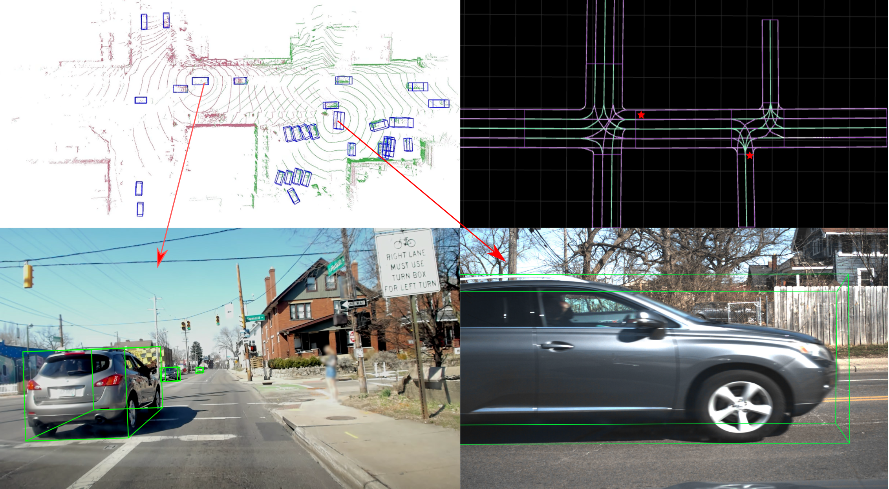

# Uncertainty Estimation for Cooperative 3D Object Detection (V2V4Real)

This repository adds **uncertainty estimation** to cooperative (vehicle-to-vehicle) 3D object
detectors. The detectors are trained on the **OPV2V** simulation dataset and tested on the real-world **V2V4Real** dataset.

The code is built on the official [V2V4Real](https://github.com/ucla-mobility/V2V4Real) codebase, which is built on
[OpenCOOD](https://github.com/DerrickXuNu/OpenCOOD). All original features still work. See the
[original README](https://github.com/ucla-mobility/V2V4Real#readme) for them.

<p align="center">

</p>

## What this repo adds

A detector normally gives a box and a confidence score. It does not say **how sure it is about the box position and size**.
This repo adds that: every predicted box also gets a **variance** (an "error bar") for x, y, z, height, width, length and yaw.

**Detectors** (all with a PointPillars backbone, intermediate fusion):

| Detector | Paper | Configs |
|---|---|---|
| F-Cooper | [SEC 2019](https://arxiv.org/abs/1909.06459) | `opencood/hypes_yaml/fcooper/` |
| AttFuse (Attentive Fusion) | [ICRA 2022](https://arxiv.org/abs/2109.07644) | `opencood/hypes_yaml/attfuse/` |
| CoBEVT | [CoRL 2022](https://arxiv.org/abs/2207.02202) | `opencood/hypes_yaml/cobevt/` |

**Uncertainty methods:**

| Method | Idea in one line | Needs training? |
|---|---|---|
| **Laplace approximation** (last layer or full network) | Fits a Gaussian around the trained weights and turns it into a variance per box. | No, it's added after training |
| **Variance network, β-NLL** | The network has an extra head that predicts the variance; trained with the β-NLL loss. | Yes |
| **Variance network, Energy Score (ES)** | Same extra head, trained with the Energy Score loss. | Yes |
| **MC-dropout** | Dropout stays on at test time; the spread over 20 forward passes is the uncertainty. | Yes (model with dropout) |
| **Variance network + Laplace** | Variance-network variance (data noise) + Laplace variance (model uncertainty). | Yes (the VN run) |

## Setup

Same as the original V2V4Real codebase:

```shell
conda create -n v2v4real python=3.7
conda activate v2v4real
conda install pytorch==1.12.0 torchvision==0.13.0 cudatoolkit=11.3 -c pytorch -c conda-forge
pip install spconv-cu113
pip install -r requirements.txt
python setup.py develop
python opencood/utils/setup.py build_ext --inplace
```

## Data

Download both datasets (OPV2V format):
- OPV2V: https://mobility-lab.seas.ucla.edu/opv2v/ (used for training)
- V2V4Real: https://research.seas.ucla.edu/mobility-lab/v2v4real/ (used for testing)

```
opv2v_data/       train/  validate/  test/
v2v4real_data/    train/  validate/  test/
```

**Before training, change the paths at the top of each config** (`root_dir`, `validate_dir`) to your own data folders.

## How to use

Run all commands from the repository root. Choose the GPU with `CUDA_VISIBLE_DEVICES`.

### 1. Train

```shell
# Baseline detector (no uncertainty)
python opencood/tools/train.py --hypes_yaml opencood/hypes_yaml/fcooper/point_pillar_fcooper.yaml

# Variance network with β-NLL
python opencood/tools/train.py --hypes_yaml opencood/hypes_yaml/fcooper/point_pillar_fcooper_VN_NLL.yaml

# Variance network with Energy Score
python opencood/tools/train.py --hypes_yaml opencood/hypes_yaml/fcooper/point_pillar_fcooper_VN_ES.yaml

# MC-dropout model
python opencood/tools/train.py --hypes_yaml opencood/hypes_yaml/fcooper/point_pillar_fcooper_MC.yaml
```

The AttFuse and CoBEVT configs work the same way (`attfuse/...`, `cobevt/...`). Checkpoints are saved in `opencood/logs/<name>_<date>/`.
Every uncertainty config uses **the same training settings as its own baseline**; only the model head and the loss change.

### 2. Pick a checkpoint

Training saves 60 checkpoints. I pick the one with the **lowest OPV2V validation loss** from epochs 31–60. For variance
networks, only the detection part of the loss (classification + box regression) is used, so the choice is comparable to the baseline.

```shell
python opencood/tools/det_val_loss.py opencood/logs/<run_folder> 31 60 val_loss.csv
```

It writes one row per checkpoint. Use the `det_loss` column and take the epoch with the lowest value.

### 3. Prepare a test folder

Make a folder with the chosen checkpoint and a copy of its `config.yaml`. In that copy, set:

```yaml
dataset: v2v4real
validate_dir: /path/to/v2v4real_data/test
```

All evaluations use `score_threshold: 0.2` (in `postprocess`). This matters, because the AP code does not sort boxes by score
across frames.

### 4. Test on V2V4Real

```shell
# Baseline: detection AP only
python opencood/tools/inference.py --model_dir <test_folder> --fusion_method intermediate

# Variance network (β-NLL or ES)
python opencood/tools/inference_vn.py --model_dir <test_folder> --fusion_method intermediate

# MC-dropout (20 forward passes)
python opencood/tools/inference_mc.py --model_dir <test_folder> --fusion_method intermediate --mc_passes 20
```

### 5. Laplace (after training, on a baseline or a variance-network model)

Two steps: compute the curvature on the OPV2V training set, then test on V2V4Real.

```shell
# Last layer (detection heads only)
python opencood/tools/compute_laplace.py   --model_dir <test_folder> --laplace_dir <laplace_out> --param_scope heads
python opencood/tools/inference_laplace.py --model_dir <test_folder> --laplace_dir <laplace_out> --param_scope heads

# Full network
python opencood/tools/compute_laplace.py   --model_dir <test_folder> --laplace_dir <laplace_out> --param_scope full
python opencood/tools/inference_laplace.py --model_dir <test_folder> --laplace_dir <laplace_out> --param_scope full
```

Good to know:
- `compute_laplace.py` switches the dataset back to OPV2V by itself, so the same test folder works for both steps.
- The curvature is the **GGN** (generalized Gauss-Newton) for the last layer and a **sampled Fisher** for the full network.
  The empirical Fisher (`--curvature ef`) is available but **not recommended**: with focal loss it collapses to almost zero
  (in my test, AP −6 points and much worse uncertainty).
- The prior precision is chosen automatically (`--prior_precision auto`, by marginal likelihood).
- On a variance-network model, the total variance = predicted variance (data noise) + Laplace variance (model uncertainty).
- Time on one A100: last layer about 1.5 h, full network about 10–12 h (mostly the test pass).

### 6. Outputs

Each test run writes into its folder:
- `eval.yaml`, `short_eval.yaml`, `middle_eval.yaml`, `long_eval.yaml`: AP at IoU 0.3 and 0.5, overall and by distance
  (0–30 m, 30–50 m, 50–100 m)
- `paper_ece_summary_*.json`: classification ECE and regression ECE (calibration)
- `error_vs_variance_*.csv`: one row per matched box (real centre error in metres, predicted variance)

### 7. Uncertainty metrics and plots (`metrics/`)

```shell
# AUSE, Pearson and Spearman from the error-vs-variance CSVs
python metrics/compute_uncertainty_metrics.py --csv <run>/error_vs_variance_laplace.csv --label "Laplace full"

# Sparsification curves (repeat --csv/--label per method)
python metrics/plot_sparsification.py --csv a.csv --label A --csv b.csv --label B --out sparsification.png

# Error vs predicted uncertainty (RMV vs RMSE) and ENCE
python metrics/plot_error_vs_var.py --csv a.csv --label A --csv b.csv --label B --out_dir plots/
```

Bird's-eye-view figures: `opencood/tools/visualize_scene_uncertainty.py` (whole scene, boxes coloured by uncertainty) and
`opencood/tools/visualize_object_uncertainty.py` (uncertainty contours around single objects).

## Metrics in short

| Metric | Question it answers | Better |
|---|---|---|
| AP@0.5 | Are the boxes correct? | higher |
| Classification ECE | Is the confidence score honest? | lower |
| Regression ECE | Are the box error bars the right size? | lower |
| AUSE / gap closed | Do the most uncertain boxes have the largest errors? (ranking) | lower AUSE / higher gap closed |
| Spearman | Same question, as a rank correlation | higher |
| ENCE | Does the predicted error size match the real error size? | lower |

## Main results (train OPV2V → test V2V4Real)

Best checkpoint of each run, score threshold 0.2. "Gap closed" = how much of the way from a random to a perfect ranking a
method gets.

| Detector | Method | AP@0.5 | Reg. ECE ↓ | Gap closed ↑ | ENCE ↓ |
|---|---|---|---|---|---|
| F-Cooper | Baseline | 0.462 | – | – | – |
| F-Cooper | Baseline + Laplace full network | 0.453 | 0.125 | 41% | 1.42 |
| F-Cooper | VN-β-NLL | 0.341 | 0.113 | 40% | 1.89 |
| AttFuse | Baseline | 0.458 | – | – | – |
| AttFuse | Baseline + Laplace full network | 0.455 | 0.111 | 31% | 1.15 |
| AttFuse | VN-β-NLL + Laplace last layer | 0.482 | 0.091 | 46% | 1.29 |
| CoBEVT | Baseline | 0.410 | – | – | – |
| CoBEVT | Baseline + Laplace full network | 0.418 | 0.124 | 31% | 1.31 |
| CoBEVT | VN-β-NLL + Laplace full network | 0.419 | 0.097 | 48% | 0.97 |

Main findings:
- **Baseline + full-network Laplace** is the safe default. It needs no retraining, keeps the detection accuracy
  (at most −0.9 AP) and gives a useful uncertainty on all three detectors.
- **β-NLL (+ Laplace)** gives the best uncertainty, but only where training keeps the AP (AttFuse, CoBEVT). On F-Cooper it lost
  12 AP points.
- **Full network beats the last layer** for Laplace on every detector. On CoBEVT the last layer is no better than random.
- **All methods are overconfident on real data.** The real error is about 2–3× the predicted one, because the uncertainty
  was learned in simulation.

## Where things are

| Path | Content |
|---|---|
| `opencood/hypes_yaml/{fcooper,attfuse,cobevt}/` | Configs: baseline, `_VN_ES` (Energy Score), `_VN_NLL` (β-NLL), `_MC` (dropout) |
| `opencood/models/*_VN.py`, `*_MC.py` | Detectors with a variance head / with MC-dropout |
| `opencood/loss/point_pillar_VN_loss_ES.py`, `point_pillar_VN_loss_NLL.py` | Energy Score and β-NLL losses |
| `opencood/uncertainty/diagonal_laplace.py` | Diagonal Laplace approximation (curvature, prior, predictive) |
| `opencood/tools/` | Training, checkpoint selection (`det_val_loss.py`), inference, Laplace and visualization scripts |
| `metrics/` | Calibration, AUSE, sparsification and error-vs-variance tools |

on Based Epistemic Uncertainty Estimation in 3D Object Detection" (CoRL 2022).
